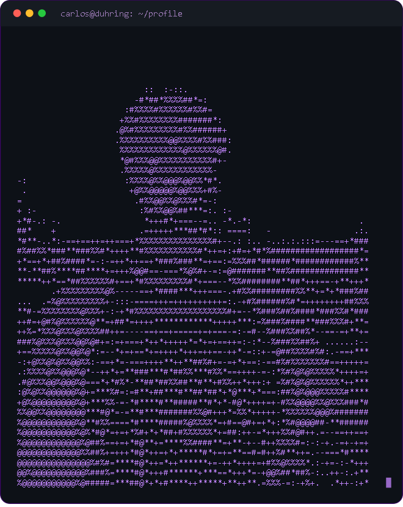
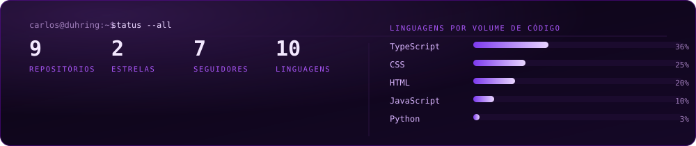
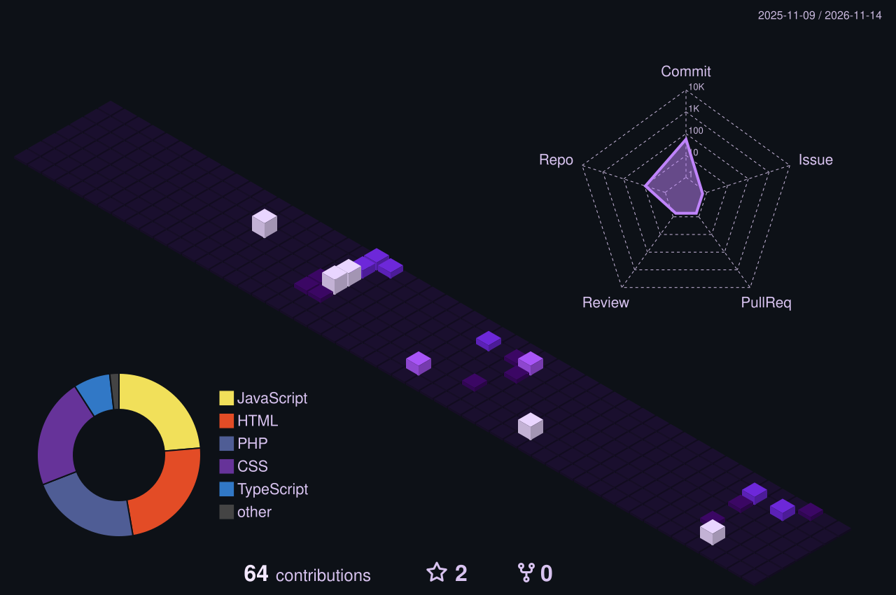

<div align="center">
  
</div>

<div align="center">
  
</div>

<p align="center">
  
  &nbsp;
  <a href="mailto:carlosduhring@gmail.com"></a>
</p>

---

## Sobre mim



Tenho **16 anos**, moro em **Joinville/SC** e curso o **Técnico em Desenvolvimento de Sistemas no SENAI** em paralelo ao ensino médio. Estudo desenvolvimento web e cibersegurança, com Python, PHP, JavaScript e TypeScript no dia a dia e Linux como sistema principal. Também faço cursos livres pela **Cisco NetAcad** e pelo **IFRS**.

- Cursando Técnico em Desenvolvimento de Sistemas — SENAI
- Certificações Cisco NetAcad em cibersegurança e redes
- Cursos IFRS de lógica de programação, HTML5 e inglês básico
- Fora do código: hardware, games e música

```python
carlos = {
    "nome": "Carlos Eduardo Duhring",
    "cidade": "Joinville, SC",
    "formacao": [ "Técnico em Desenvolvimento de Sistemas — SENAI",
                  "Ensino Médio — Escola Gov. Celso Ramos" ],
    "stack": ["Python", "PHP", "JavaScript", "TypeScript", "Java", "C"],
    "estudando": ["Desenvolvimento Web", "Cibersegurança"],
    "filosofia": "Crescer é resultado de esforço, curiosidade e atitude."
}
```

---

## Habilidades & Stack

<h3 align="center">Linguagens</h3>

<p align="center">
  
  &nbsp;
  
  &nbsp;
  
  &nbsp;
  
  &nbsp;
  
  &nbsp;
  
</p>

<h3 align="center">Web & Front-end</h3>

<p align="center">
  
  &nbsp;
  
  &nbsp;
  
</p>

<h3 align="center">Back-end</h3>

<p align="center">
  
  &nbsp;
  
  &nbsp;
  
  &nbsp;
  
  &nbsp;
  
</p>

<h3 align="center">Banco de Dados</h3>

<p align="center">
  
  &nbsp;
  
  &nbsp;
  
</p>

<h3 align="center">Infra & Ferramentas</h3>

<p align="center">
  
  &nbsp;
  
  &nbsp;
  
  &nbsp;
  
  &nbsp;
  
</p>

<h3 align="center">Cursos & Certificações</h3>

<p align="center">
  
  &nbsp;
  
  &nbsp;
  
</p>

<p align="center">
  
  &nbsp;
  
  &nbsp;
  
</p>

---

## Estatísticas do GitHub

<p align="center">
  
</p>

<p align="center">
  
</p>

---

## Calendário de contribuições em 3D

<p align="center">
  <picture>
    <source media="(prefers-color-scheme: dark)" srcset="https://raw.githubusercontent.com/CarlosDuhring/CarlosDuhring/output-3d-contrib/night.svg" />
    <source media="(prefers-color-scheme: light)" srcset="https://raw.githubusercontent.com/CarlosDuhring/CarlosDuhring/output-3d-contrib/day.svg" />
    
  </picture>
</p>

---

## Contribuições em movimento

<p align="center">
  <picture>
    <source media="(prefers-color-scheme: dark)" srcset="https://raw.githubusercontent.com/CarlosDuhring/CarlosDuhring/output/github-contribution-grid-snake-dark.svg" />
    <source media="(prefers-color-scheme: light)" srcset="https://raw.githubusercontent.com/CarlosDuhring/CarlosDuhring/output/github-contribution-grid-snake.svg" />
    
  </picture>
</p>

---

## Projetos em destaque

| Projeto | Sobre |
|:--------|:------|
| **<a href="https://github.com/CarlosDuhring/talentbridge">talentbridge</a>** | Plataforma de recrutamento com IA: análise de currículos, avaliação de competências e execução de código isolada em containers.<br>`TypeScript` `Prisma` `Docker` |
| **<a href="https://github.com/CarlosDuhring/TrueHate">TrueHate</a>** | Canal de denúncias internas com relatos anônimos ou identificados, painel administrativo e controle de usuários.<br>`Flask` `MySQL` `HTML5` `CSS3` |
| **<a href="https://github.com/CarlosDuhring/umidade-esp32">umidade-esp32</a>** | Monitor de umidade do solo com ESP32 e dashboard web para acompanhamento em tempo real.<br>`C/C++` `Node.js` `PostgreSQL` |
| **<a href="https://github.com/CarlosDuhring/Portfolio">Portfolio</a>** | Portfólio pessoal publicado no GitHub Pages.<br>`HTML5` `CSS3` `JavaScript` |
| **<a href="https://github.com/CarlosDuhring/Crud-PHP">Crud-PHP</a>** | Sistema de cadastro com criação, leitura, atualização e exclusão integrado ao banco de dados.<br>`PHP` `MySQL` `Bootstrap` |
| **<a href="https://github.com/CarlosDuhring/Celso_ramos">Celso_ramos</a>** | Trabalhos e exercícios desenvolvidos no ensino médio.<br>`HTML5` `CSS3` |

---

## Vamos conversar?

<p align="center"><em>Aberto a conversas sobre tecnologia, desenvolvimento web, cibersegurança e novas ideias.</em></p>

<p align="center">
  <a href="https://carlosduhring.github.io/Portfolio/"></a>
  &nbsp;
  <a href="https://www.linkedin.com/in/carlosduhring"></a>
  &nbsp;
  <a href="https://instagram.com/carlos_duhring"></a>
  &nbsp;
  <a href="mailto:carlosduhring@gmail.com"></a>
  &nbsp;
  <a href="https://github.com/CarlosDuhring"></a>
</p>

<br/>

<p align="center">
  
</p>
