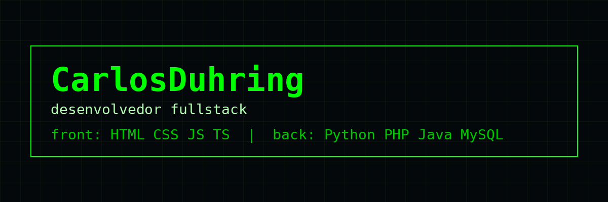
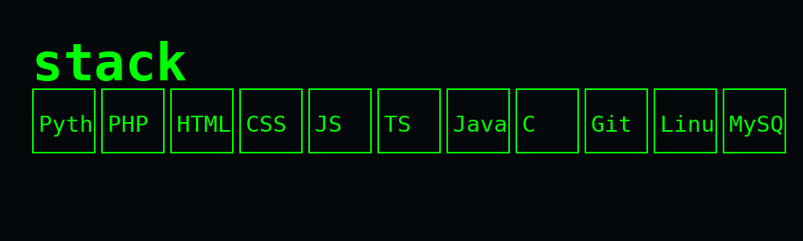

# CarlosDuhring
### desenvolvedor fullstack



```bash
$ whoami
carlosduhring -- desenvolvedor fullstack
```

## about

Desenvolvedor fullstack. Atuo do front ao back: interfaces, APIs, banco de dados e automação em Linux.

- Front: HTML, CSS, JavaScript, TypeScript
- Back: Python, PHP, Java, MySQL
- Ambiente: Linux, Git
- Contato: abra uma issue em qualquer repositório público



## repositories

- [talentbridge](https://github.com/CarlosDuhring/talentbridge) - Plataforma de recrutamento
- [TrueHate](https://github.com/CarlosDuhring/TrueHate) - Plataforma web de relatos
- [Portfolio](https://github.com/CarlosDuhring/Portfolio) - Portfolio pessoal
- [Celso_ramos](https://github.com/CarlosDuhring/Celso_ramos) - Site institucional
- [Crud-PHP](https://github.com/CarlosDuhring/Crud-PHP) - CRUD PHP + MySQL
- [ExercicioCRUD](https://github.com/CarlosDuhring/ExercicioCRUD) - Exercicios CRUD
