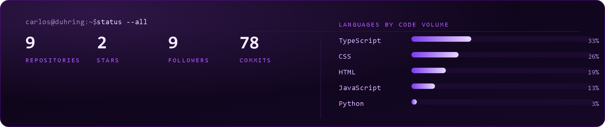
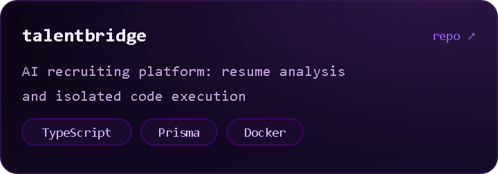
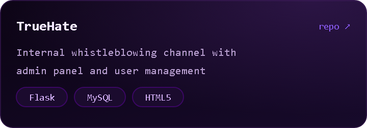
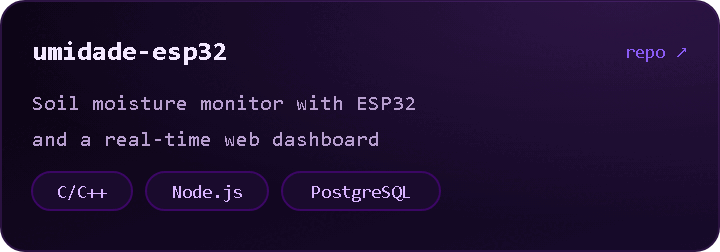
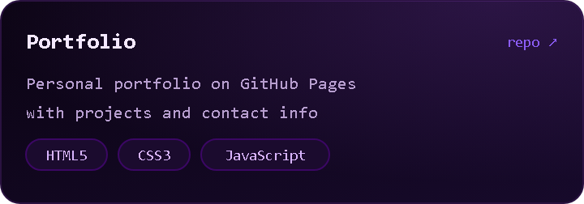
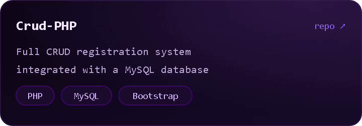
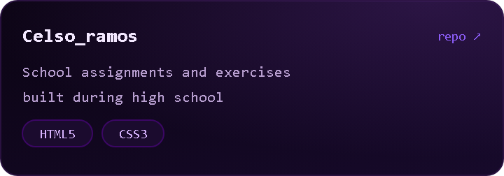

<div align="center">
  
</div>

<div align="center">
  
</div>

<p align="center">
  
  &nbsp;
  <a href="mailto:carlosduhring@gmail.com"></a>
</p>

---

## About me


I'm **16 years old**, based in **Joinville, Brazil**. I build web applications end to end with **Python, PHP, JavaScript and TypeScript**, with **Linux** as my main system, and I also work with **cybersecurity** — certified by **Cisco NetAcad** and **IFRS**.

- Full stack web developer — Python, PHP, JavaScript and TypeScript
- Cisco NetAcad certifications in cybersecurity and networking
- IFRS courses in programming logic, HTML5 and basic English
- Outside of code: hardware, games and music

```python
carlos = {
    "name": "Carlos Eduardo Duhring",
    "city": "Joinville, SC — Brazil",
    "education": [ "Software Development — SENAI",
                   "High School — Gov. Celso Ramos" ],
    "stack": ["Python", "PHP", "JavaScript", "TypeScript", "Java", "C"],
    "focus": ["Web Development", "Cybersecurity"],
    "philosophy": "Growth is the result of effort, curiosity and attitude."
}
```

---

## Skills & Stack

<h3 align="center">Languages</h3>

<p align="center">
  
  &nbsp;
  
  &nbsp;
  
  &nbsp;
  
  &nbsp;
  
  &nbsp;
  
</p>

<h3 align="center">Web & Front-end</h3>

<p align="center">
  
  &nbsp;
  
  &nbsp;
  
</p>

<h3 align="center">Back-end</h3>

<p align="center">
  
  &nbsp;
  
  &nbsp;
  
  &nbsp;
&nbsp;
  
  &nbsp;
  
  &nbsp;
  
</p>

<h3 align="center">Databases</h3>

<p align="center">
  
  &nbsp;
  
  &nbsp;
  
</p>

<h3 align="center">Infra & Tools</h3>

<p align="center">
  
  &nbsp;
  
  &nbsp;
  
  &nbsp;
  
  &nbsp;
  
</p>

<h3 align="center">Courses & Certifications</h3>

<p align="center">
  
  &nbsp;
  
  &nbsp;
  
</p>

<p align="center">
  
  &nbsp;
  
  &nbsp;
  
</p>

---

## GitHub Stats

<p align="center">
  
</p>

<p align="center">
  
</p>

---

## 3D contribution calendar

<p align="center">
  
</p>

---

## Contributions in motion

<p align="center">
  <picture>
    <source media="(prefers-color-scheme: dark)" srcset="https://raw.githubusercontent.com/CarlosDuhring/CarlosDuhring/output/github-contribution-grid-snake-dark.svg" />
    <source media="(prefers-color-scheme: light)" srcset="https://raw.githubusercontent.com/CarlosDuhring/CarlosDuhring/output/github-contribution-grid-snake.svg" />
    
  </picture>
</p>

---

## Featured projects

<p align="center">
  <a href="https://github.com/CarlosDuhring/talentbridge"></a>
  &nbsp;
  <a href="https://github.com/CarlosDuhring/TrueHate"></a>
</p>

<p align="center">
  <a href="https://github.com/CarlosDuhring/umidade-esp32"></a>
  &nbsp;
  <a href="https://github.com/CarlosDuhring/Portfolio"></a>
</p>

<p align="center">
  <a href="https://github.com/CarlosDuhring/Crud-PHP"></a>
  &nbsp;
  <a href="https://github.com/CarlosDuhring/Celso_ramos"></a>
</p>

---

## Let's connect

<p align="center"><em>Open to conversations about technology, web development, cybersecurity and new ideas.</em></p>

<p align="center">
  <a href="https://carlosduhring.github.io/Portfolio/"></a>
  &nbsp;
  <a href="https://www.linkedin.com/in/carlosduhring"></a>
  &nbsp;
  <a href="https://instagram.com/carlos_duhring"></a>
  &nbsp;
  <a href="mailto:carlosduhring@gmail.com"></a>
  &nbsp;
  <a href="https://github.com/CarlosDuhring"></a>
</p>

<br/>

<p align="center">
  
</p>
